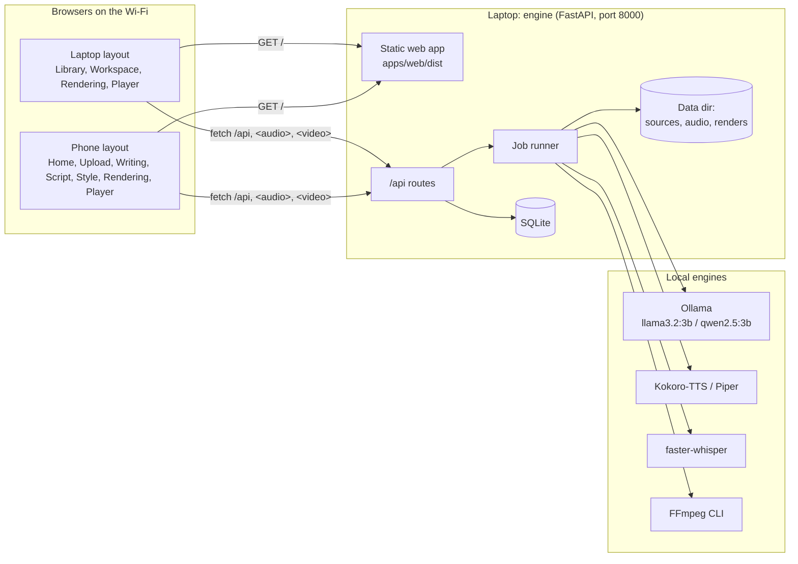
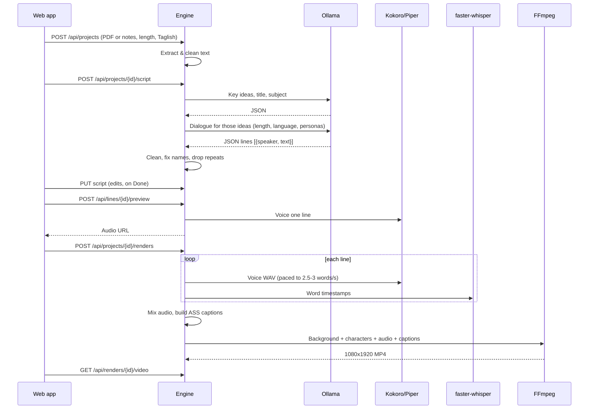
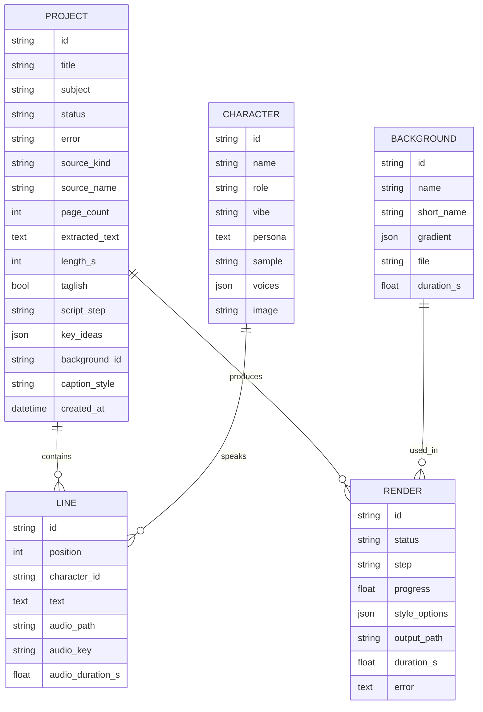

# Architecture

How the system is built: its parts, how data moves through them, and the core entities. Product scope lives in [product.md](product.md); the reasoning behind these choices is in [decisions/](decisions/) (see [002](decisions/002-web-app-frontend.md) for why the frontend is a web app).

## Overview

One process on the user's laptop, the **engine** (FastAPI), does all the work:

- **REST API** under `/api`: videos (projects), scripts, previews, renders, assets.
- **AI pipeline:** text extraction, LLM, TTS, alignment, and FFmpeg rendering, run by a background worker.
- **Web app** at `/`: the Figma-built React app (`apps/web/dist`), with a laptop layout (1180 px and wider) and a phone layout.

Laptops and phones on the same Wi-Fi open `http://<laptop-ip>:8000`. The app and API share an origin, so there's no CORS and no server address to configure. No component calls the internet at runtime.

## System diagram

## Components

### Web app (`apps/web`)

Routes, Figma frame mapping and design rules are in [apps/web/HANDOFF.md](../apps/web/HANDOFF.md).

| Part | Responsibility |
|---|---|
| `screens/desktop/` | Library, Workspace (script + live preview + style), Rendering, Player |
| `screens/mobile/` | Home, Upload, Writing script, Script editor, Style, Rendering, Player |
| `App.tsx`, `lib/useIsDesktop.ts` | One URL per step; the window width picks the laptop or phone screen |
| `lib/api.ts` | Typed client for `/api`; pairing token from `?token=` remembered in localStorage |
| `lib/store.tsx` | App-wide state: video library (polled while anything is in progress), engine health, backgrounds, the new-video draft |
| `lib/useProject.ts` | One video: loads it, polls during script writing or rendering, style and render actions |
| `components/ScriptList.tsx` | Script editing: saves on Done, before previewing a changed line, and before leaving the script |
| `lib/videos.ts` | Maps engine projects to the UI's video cards and decides which screen a video opens on |
| `lib/audio.ts` | One shared `<audio>` for line previews and voice samples |
| `components/VideoFrame.tsx` | The 9:16 preview (gradient, floor band, caption) used for thumbnails and live previews |
| `components/VideoPlayer.tsx` | The real MP4 on the player screens; download and share |

### Engine (`server/app`)

| Module | Responsibility |
|---|---|
| `main.py` | App factory: `/api` routers, serves the built web app with an index.html fallback for client routes |
| `routes/` | REST endpoints (see below); `deps.py` checks the pairing token |
| `pipeline/extract.py` | PDF to clean text with PyMuPDF (page selection, limits); pasted notes and .txt/.md |
| `pipeline/script.py` | Two Ollama calls with JSON schemas: key ideas, title and subject (`prompts/ideas.txt`), then the dialogue (`prompts/dialogue.txt`) for the chosen length and language; cleaning, name fixes, de-duplication, retries |
| `pipeline/tts.py` | Kokoro, Piper, or a `dummy` engine; one cached WAV per line, paced to 2.5-3 words per second |
| `pipeline/align.py` | faster-whisper word timestamps mapped onto the script's own words; estimated timing as a fallback |
| `pipeline/captions.py` | ASS subtitles: two-line blocks, mustard active word, three styles, speaker labels |
| `pipeline/render.py` | FFmpeg commands: audio mix (gaps, loudness), clip or gradient background, character overlays, captions; progress and cancel |
| `workflow.py` | Runs the steps in order and records progress (script step, render step and percentage) |
| `jobs.py` | One background worker thread; cancellation; marks interrupted work as failed on restart |
| `assets.py` | Characters and backgrounds from `assets/*/manifest.json` |
| `db.py`, `models.py`, `schemas.py` | SQLite via SQLModel (adds new columns to older databases); API shapes |
| `scripts/` | CLI tools: `init_db`, `download_models`, `script_sample`, `render_sample`, `make_placeholder_characters` |

### API surface

Interactive docs: `http://<laptop>:8000/api/docs`. When `API_PAIRING_TOKEN` is set, every endpoint except `/api/health` needs the `X-Pairing-Token` header (or `?token=` for media URLs).

| Method & path | Purpose |
|---|---|
| `GET /api/health` | Engine status, user name, and whether the token is accepted |
| `GET /api/projects` | All videos with line count, latest render and latest finished video |
| `POST /api/projects` | Create from a file (`file`: PDF, .txt, .md) or `notes`, with `length_s` (30/60/90), `taglish`, optional `title`, `pages` |
| `GET /api/projects/{id}` | Video with script, key ideas, style and renders |
| `PATCH /api/projects/{id}` | Rename, or save `background_id`, `caption_style`, `taglish`, `length_s` |
| `DELETE /api/projects/{id}` | Delete the video and its files |
| `POST /api/projects/{id}/script` | Start writing (or rewriting) the script; returns 202. Poll `script_step` |
| `PUT /api/projects/{id}/script` | Save edited lines in order (existing ids keep their cached audio) |
| `POST /api/lines/{id}/preview` | Voice one saved line; returns an audio URL |
| `GET /api/lines/{id}/audio` | The line's WAV |
| `POST /api/projects/{id}/renders` | Start a render with the saved (or given) background and caption style; returns 202 |
| `GET /api/renders/{id}` | Status, current step, and progress |
| `DELETE /api/renders/{id}` | Cancel a queued or running render |
| `GET /api/renders/{id}/video` | The MP4 (`?download=1` to save instead of play) |
| `POST /api/renders/{id}/reveal` | Show the MP4 in the laptop's file manager ("Open folder") |
| `GET /api/assets/characters`, `…/{id}/image`, `…/{id}/sample` | Cast, their art, and a voice sample |
| `GET /api/assets/backgrounds` | Backgrounds with names and gradient colors |

Long-running work returns immediately; the app polls the project (about every second while busy).

## Data flow: PDF to video

### Render composition

- **Canvas:** 1080x1920, 30 fps.
- **Background:** gameplay clip scaled and cropped to fill, looped, random start offset; or, without a clip, the background's gradient plus the light floor band from the app preview.
- **Characters:** the speaking character's image is shown while their line plays, with their name above.
- **Captions:** ASS subtitles burned in: up to two lines of up to three words, the spoken word in mustard, one block at a time. Styles in [design.md](design.md).
- **Audio:** per-line WAVs concatenated with a short gap, loudness-normalized.

## Core entities

`CHARACTER` and `BACKGROUND` are read from `assets/*/manifest.json`; the rest are SQLite tables. A "video" in the app is a `PROJECT`; its player shows the newest finished `RENDER`. A line's `audio_key` hashes its text, engine, voice and pace, so editing a line invalidates only that line's audio; word timestamps are cached next to the WAV as `.words.json`.

## Integrations

All integrations are local processes or libraries. Details and configuration are in [services.md](services.md).

| Integration | How we call it |
|---|---|
| Ollama | HTTP API at `OLLAMA_HOST`; `format` is a JSON schema so replies are structured |
| Kokoro-TTS / Piper | Python libraries, selected by `TTS_ENGINE` (`dummy` for development without models) |
| faster-whisper | Python library, model chosen by `WHISPER_MODEL` |
| FFmpeg | Subprocess, binary at `FFMPEG_PATH` |
| PyMuPDF | Python library for PDF text extraction |

## Cross-cutting concerns

- **Privacy:** the engine serves only the local network. No outbound calls; FastAPI's built-in OpenTelemetry hooks are switched off in `app/main.py`. Fonts are bundled with the web app (no CDN).
- **Security:** no user accounts. A shared pairing token (`API_PAIRING_TOKEN`) keeps other devices on the same network out; the web app picks it up once from `?token=`.
- **Errors:** each pipeline step writes its error to the project or render; the app shows it inline with a retry.
- **Storage:** everything lives under `DATA_DIR`; deleting a video deletes its folder.
