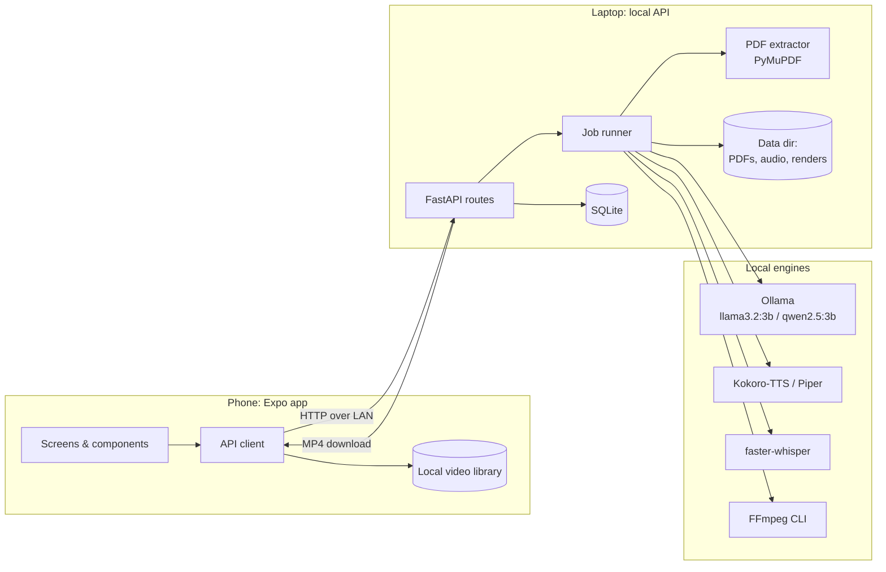
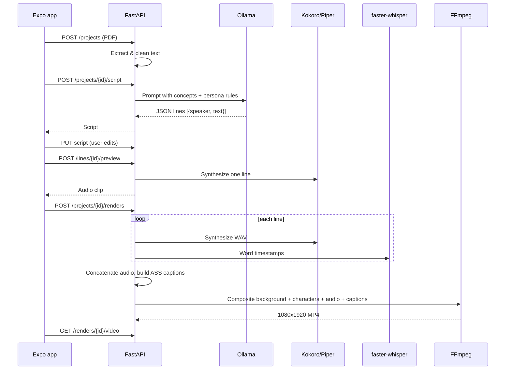
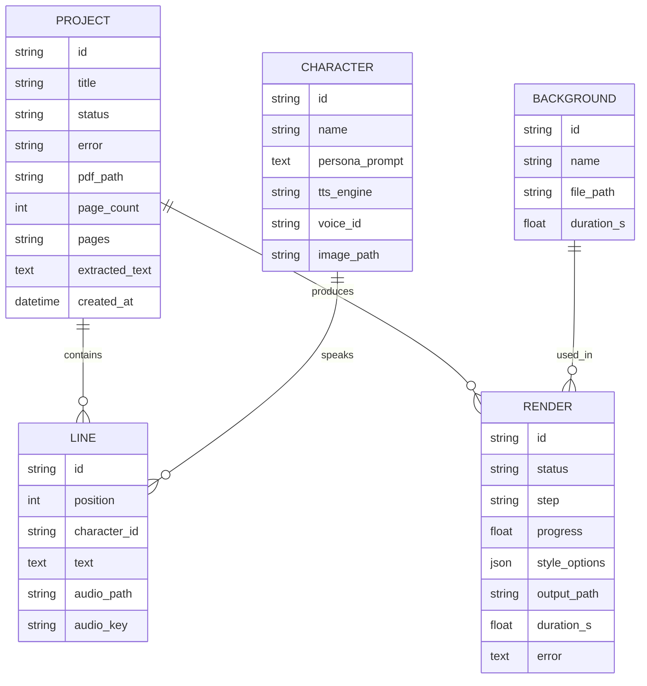

# Architecture

How the system is built: its parts, how data moves through them, and the core entities. Product scope lives in [product.md](product.md); the reasoning behind these choices is in [decisions/](decisions/).

## Overview

Two processes on the user's local network:

- **Mobile app** (React Native / Expo). UI only: upload, script editing, previews, playback, and the video library.
- **Local API** (FastAPI on a laptop or desktop). Runs the AI pipeline: PDF extraction, LLM, TTS, alignment, and FFmpeg rendering.

The phone talks to the API over HTTP on the LAN. No component calls the internet at runtime.

## System diagram

## Components

### Mobile app (`apps/mobile`)

| Part | Responsibility |
|---|---|
| Screens (`src/app/`, Expo Router) | Library (`index`), Server settings, Upload (`new`), Script editor (`project/[id]`), Style picker (`project/[id]/style`), Render progress and result (`render/[id]`), Player for saved videos (`watch`) |
| API client (`src/lib/api.ts`) | Typed wrapper over the REST API; sends the pairing token header |
| Server connection (`src/lib/server.tsx`) | Address and token, saved with AsyncStorage, prefilled from `EXPO_PUBLIC_API_URL`; the Settings screen tests `/health` |
| Polling (`src/lib/hooks.ts`) | Reloads on screen focus; polls while a script or render is in progress |
| Local library (`src/lib/library.ts`) | Downloaded MP4s plus a `library.json` index in the app's document directory |
| Media | `expo-audio` for line previews, `expo-video` for playback, `expo-sharing` for share |
| Styling | NativeWind 4 (Tailwind 3 classes), tokens from [design.md](design.md) in `tailwind.config.js` |

### Local API (`server/app`)

| Module | Responsibility |
|---|---|
| `routes/` | REST endpoints (see below); `deps.py` checks the pairing token |
| `pipeline/extract.py` | PDF to clean text with PyMuPDF; page selection; page and size limits |
| `pipeline/script.py` | Prompting Ollama with a JSON schema (`prompts/dialogue.txt`); validating, cleaning, and retrying the output |
| `pipeline/tts.py` | Engine adapter for Kokoro, Piper, or a `dummy` engine for development; one cached WAV per line |
| `pipeline/align.py` | faster-whisper word timestamps for each line, mapped onto the script's own words; estimated timing as a fallback |
| `pipeline/captions.py` | Builds an ASS subtitle file with word-by-word highlight and speaker labels |
| `pipeline/render.py` | FFmpeg commands: audio mix (gaps, loudness), background, character overlays, burned-in captions; progress and cancel |
| `workflow.py` | Runs the steps in order and records progress on the job |
| `jobs.py` | One background worker thread; cancellation; marks interrupted work as failed on restart |
| `assets.py` | Loads characters and background clips from `assets/*/manifest.json`; built-in backgrounds |
| `db.py`, `models.py`, `schemas.py` | SQLite via SQLModel; API request/response shapes |
| `scripts/` | CLI tools: `init_db`, `download_models`, `script_sample`, `render_sample`, `make_placeholder_characters` |

### API surface

Interactive docs: `http://<server>:8000/docs`. When `API_PAIRING_TOKEN` is set, every endpoint except `/health` needs the `X-Pairing-Token` header (or `?token=` for media URLs).

| Method & path | Purpose |
|---|---|
| `GET /health` | Liveness, engine status, and whether the token is accepted |
| `GET /projects` | All projects with their latest render |
| `POST /projects` | Upload a PDF (multipart: `file`, optional `title`, `pages`); extracts text |
| `GET /projects/{id}` | Project with its script and renders |
| `PATCH /projects/{id}` | Rename |
| `DELETE /projects/{id}` | Delete the project and its files |
| `POST /projects/{id}/script` | Start generating (or regenerating) the dialogue; returns 202 |
| `PUT /projects/{id}/script` | Save edited lines in order (existing ids keep their cached audio) |
| `POST /lines/{id}/preview` | Synthesize one saved line; returns an audio URL |
| `GET /lines/{id}/audio` | The line's WAV |
| `POST /projects/{id}/renders` | Start a render with a `background_id`; returns 202 |
| `GET /renders/{id}` | Status, current step, and progress (polled by the app) |
| `DELETE /renders/{id}` | Cancel a queued or running render |
| `GET /renders/{id}/video` | The MP4 |
| `GET /assets/characters`, `GET /assets/characters/{id}/image`, `GET /assets/backgrounds` | Personas and clips |

Long-running work (script generation, render) returns immediately; the app polls the project or render. WebSockets can replace polling later if needed.

## Data flow: PDF to video

### Render composition

- **Canvas:** 1080x1920, 30 fps.
- **Background:** gameplay clip, scaled and cropped to fill, looped to the audio length, random start offset.
- **Characters:** the speaking character's image is shown (or emphasized) while their line plays, using per-line time ranges from the audio timeline.
- **Captions:** ASS subtitles burned in, one to three words per event, active word highlighted. Styles come from [design.md](design.md).
- **Audio:** per-line WAVs concatenated with a short gap, loudness-normalized.

## Core entities

`CHARACTER` and `BACKGROUND` are read from `assets/*/manifest.json`; the rest are SQLite tables. The source PDF lives on the project row (one PDF per project). A line's `audio_key` hashes its text, engine, and voice, so editing a line invalidates only that line's audio; word timestamps are cached next to the WAV as `.words.json`.

## Integrations

All integrations are local processes or libraries. Details and configuration are in [services.md](services.md).

| Integration | How we call it |
|---|---|
| Ollama | HTTP API at `OLLAMA_HOST`; `format` is a JSON schema so the reply is structured |
| Kokoro-TTS / Piper | Python libraries, selected by `TTS_ENGINE` (`dummy` for development without models) |
| faster-whisper | Python library, model chosen by `WHISPER_MODEL` |
| FFmpeg | Subprocess, binary at `FFMPEG_PATH` |
| PyMuPDF | Python library for PDF text extraction |

## Cross-cutting concerns

- **Privacy:** the API binds to the LAN only. No outbound calls; FastAPI's built-in OpenTelemetry hooks are switched off in `app/main.py`. CI should fail if a dependency adds telemetry we can't turn off.
- **Security:** the API has no user accounts. A shared pairing token (`API_PAIRING_TOKEN`) keeps other devices on the same network from using it.
- **Errors:** each pipeline step writes its error to the job record; the app shows it and offers a retry from the failed step.
- **Storage:** everything lives under `DATA_DIR`; deleting a project deletes its folder.
