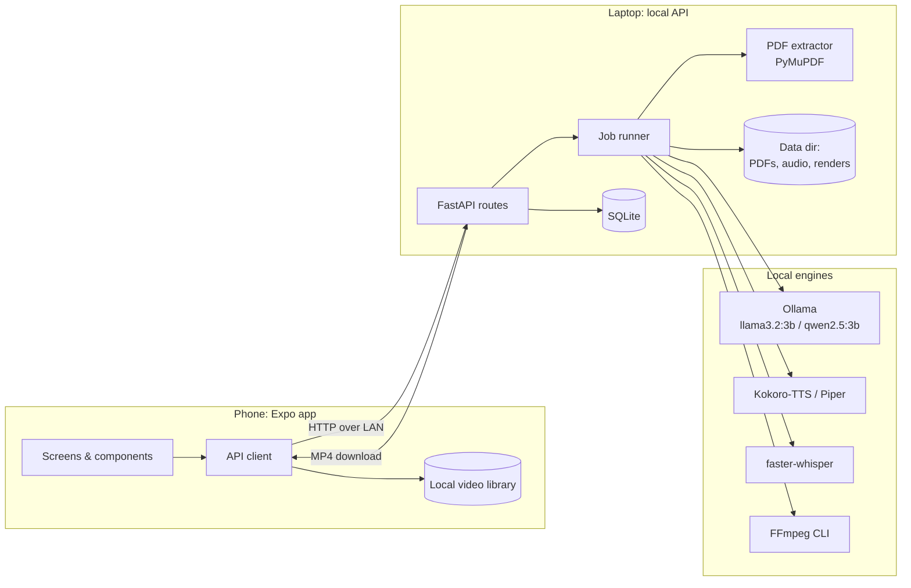
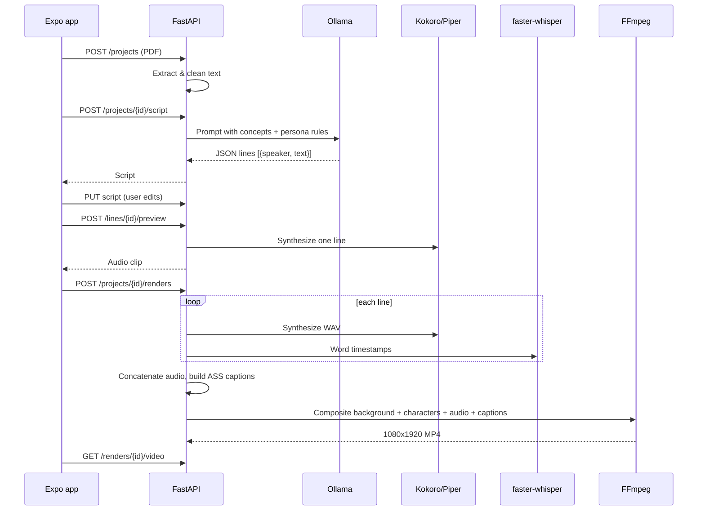
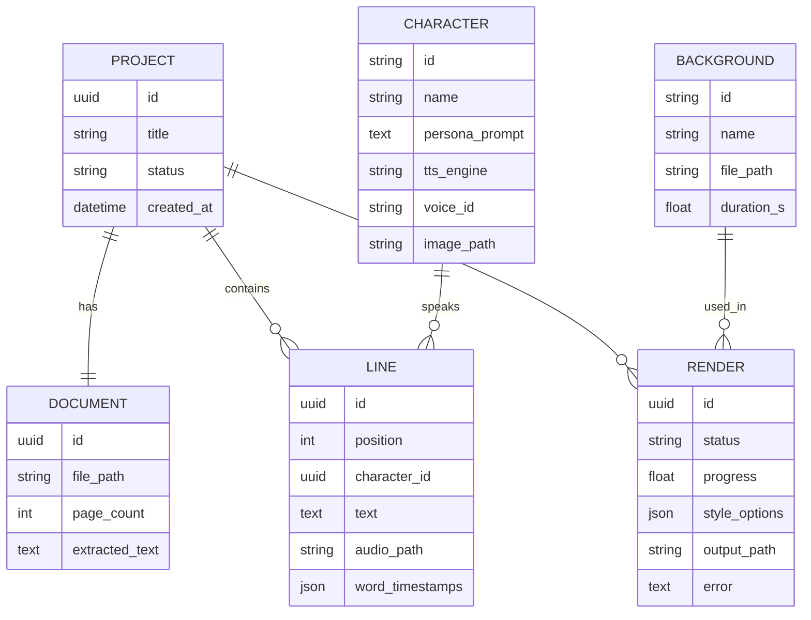

# Architecture

How the system is built: its parts, how data moves through them, and the core entities. Product scope lives in [product.md](product.md); the reasoning behind these choices is in [decisions/](decisions/).

## Overview

Two processes on the user's local network:

- **Mobile app** (React Native / Expo). UI only: upload, script editing, previews, playback, and the video library.
- **Local API** (FastAPI on a laptop or desktop). Runs the AI pipeline: PDF extraction, LLM, TTS, alignment, and FFmpeg rendering.

The phone talks to the API over HTTP on the LAN. No component calls the internet at runtime.

## System diagram

## Components

### Mobile app (`apps/mobile`)

| Part | Responsibility |
|---|---|
| Screens | Home/library, Upload, Script editor, Style picker, Render progress, Player |
| API client | Typed wrapper over the REST API; reads the base URL from `EXPO_PUBLIC_API_URL` |
| Server connection | First-run screen to enter or scan the laptop's address; health check |
| Local library | Downloaded MP4s and their metadata stored on the device |
| Styling | NativeWind (Tailwind classes), tokens from [design.md](design.md) |

### Local API (`server/app`)

| Module | Responsibility |
|---|---|
| `routes/` | REST endpoints (see below) |
| `pipeline/extract.py` | PDF to clean text with PyMuPDF; page selection; chunking for long documents |
| `pipeline/script.py` | Prompting Ollama for a JSON dialogue; validating and repairing the output |
| `pipeline/tts.py` | Engine adapter for Kokoro or Piper; one WAV per line |
| `pipeline/align.py` | faster-whisper word timestamps for each line's audio |
| `pipeline/captions.py` | Builds an ASS subtitle file with word-by-word highlight |
| `pipeline/render.py` | FFmpeg command builder: background loop, character overlays, audio, captions |
| `jobs.py` | In-process background job queue with progress and cancellation |
| `db.py`, `models.py` | SQLite via SQLModel |

### API surface (initial)

| Method & path | Purpose |
|---|---|
| `GET /health` | Liveness, plus which engines are reachable |
| `POST /projects` | Upload a PDF; creates a project and extracts text |
| `GET /projects/{id}` | Project with its current script |
| `POST /projects/{id}/script` | Generate (or regenerate) the dialogue |
| `PUT /projects/{id}/script` | Save the user's edited lines |
| `POST /lines/{id}/preview` | Synthesize one line; returns an audio URL |
| `POST /projects/{id}/renders` | Start a render with style options |
| `GET /renders/{id}` | Status and progress (polled by the app) |
| `DELETE /renders/{id}` | Cancel a running render |
| `GET /renders/{id}/video` | Download the MP4 |
| `GET /assets/backgrounds`, `GET /assets/characters` | Available clips and personas |

Long-running work (script generation, render) returns a job ID immediately; the app polls for progress. WebSockets can replace polling later if needed.

## Data flow: PDF to video

### Render composition

- **Canvas:** 1080x1920, 30 fps.
- **Background:** gameplay clip, scaled and cropped to fill, looped to the audio length, random start offset.
- **Characters:** the speaking character's image is shown (or emphasized) while their line plays, using per-line time ranges from the audio timeline.
- **Captions:** ASS subtitles burned in, one to three words per event, active word highlighted. Styles come from [design.md](design.md).
- **Audio:** per-line WAVs concatenated with a short gap, loudness-normalized.

## Core entities

`CHARACTER` and `BACKGROUND` are loaded from files in `assets/` at startup; the rest are SQLite tables.

## Integrations

All integrations are local processes or libraries. Details and configuration are in [services.md](services.md).

| Integration | How we call it |
|---|---|
| Ollama | HTTP API at `OLLAMA_HOST`, `format: json` for structured output |
| Kokoro-TTS / Piper | Python library (Kokoro) or CLI/library (Piper), selected by `TTS_ENGINE` |
| faster-whisper | Python library, model chosen by `WHISPER_MODEL` |
| FFmpeg | Subprocess, binary at `FFMPEG_PATH` |
| PyMuPDF | Python library for PDF text extraction |

## Cross-cutting concerns

- **Privacy:** the API binds to the LAN only. No outbound calls; CI should fail if a dependency adds telemetry we can't turn off.
- **Security:** the API has no user accounts. A shared pairing token (`API_PAIRING_TOKEN`) keeps other devices on the same network from using it.
- **Errors:** each pipeline step writes its error to the job record; the app shows it and offers a retry from the failed step.
- **Storage:** everything lives under `DATA_DIR`; deleting a project deletes its folder.
